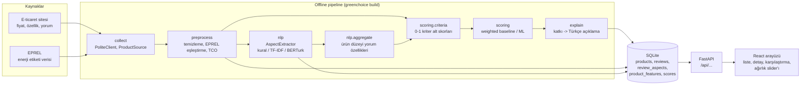

# Mimari

GreenChoice iki parçadan oluşur:

1. **Offline pipeline** (`greenchoice build`): veriyi toplar, temizler, yorumları analiz eder,
   skorları ve açıklamaları hesaplar, sonucu tek bir SQLite dosyasına yazar.
2. **Servis** (FastAPI + React): yalnızca bu veritabanını okur. Tek hesaplama, kullanıcının
   ağırlık slider'ıyla istediği yeniden skorlamadır (ucuz bir ağırlıklı toplam).

Gerçek zamanlı scraping veya model çıkarımı yok. Bu, prototip kapsamına uygundur ve
API'yi hızlı ve basit tutar.

## Modüller ve sorumlular

| Modül | Klasör | Girdi → Çıktı | Sorumlu |
|---|---|---|---|
| Veri toplama | `src/greenchoice/collect/` | site / EPREL → `data/raw/`, `data/interim/*.csv` | A (yorumlar), B (ürün, EPREL) |
| Ön işleme | `src/greenchoice/preprocess/` | ham CSV → temiz `products`, `reviews`, TCO | A (yorum), B (ürün, eşleştirme, TCO) |
| NLP | `src/greenchoice/nlp/` | `reviews.text_clean` → `review_aspects` | A (BERTurk), B (baseline, değerlendirme, toplulaştırma) |
| Kriterler | `src/greenchoice/scoring/criteria.py` | `products` + yorum özellikleri → `c_<kriter>` (0-1) | B |
| Skorlama | `src/greenchoice/scoring/` | `c_<kriter>` → skor, etiket, katkılar | B (weighted), A (ML) |
| Açıklama | `src/greenchoice/explain/` | katkılar → açıklama cümleleri | A |
| Değerlendirme | `src/greenchoice/evaluation.py`, `nlp/evaluate.py` | tahmin + manuel etiket → P/R/F1, kappa, Spearman | Ortak |
| API | `src/greenchoice/api/` | SQLite → JSON | B (A: `/explain`) |
| Arayüz | `frontend/` | JSON → ekran | B |

## Genişletme noktaları

Arayüzler sabittir, içleri değişebilir. Yeni bir yöntem eklemek mevcut kodu bozmaz:

- **Yeni veri kaynağı:** `collect.base.ProductSource`'tan türet.
- **Yeni NLP yöntemi:** `nlp.base.AspectExtractor`'dan türet (`extract` metodunu yaz).
  Pipeline'da çıkarıcıyı değiştirmek tek satırdır.
- **Yeni skorlama yöntemi:** `WeightedScorer.score` ile aynı biçimde DataFrame döndür
  (`score`, `label`, `sub_scores`, `contributions`). ML modellerinde `contributions`
  SHAP değerlerinden gelir; açıklama modülü aynen çalışır.

## Skor nasıl hesaplanıyor (weighted_v0)

1. Her kriter için 0-1 arası alt skor:

   | Kriter | Kaynak | Hesap |
   |---|---|---|
   | Enerji verimliliği | enerji sınıfı + yıllık kWh | sınıf (A=1 … G=0) ve kategori içi ters min-max kWh ortalaması |
   | Uzun vadeli maliyet | TCO | kategori içi ters min-max |
   | Dayanıklılık | yorumlar | `(durability_score + 1) / 2` |
   | Servis ve arıza | yorumlar | `1 - service_issue_rate` |
   | Fiyat avantajı | fiyat | kategori içi ters min-max |
   | Genel memnuniyet | puan | Bayes ortalaması, `(r - 1) / 4` |

2. Eksik alt skor, kategori medyanıyla doldurulur. `imputed` kolonuna yazılır, açıklamada kullanılmaz.
3. `skor = 100 × Σ ağırlık × alt skor`. Ağırlıklar `config/categories.yaml`'da, kategoriye özeldir.
4. Etiket: skor ≥ 70 Önerilir, ≥ 45 Nötr, altı Önerilmez.
5. Katkı = `100 × ağırlık × (alt skor − kategori ortalaması)`. En büyük mutlak katkılar açıklama olur.

## Bilinen sınırlar (ilerideki aşamalarda ele alınacak)

- Min-max normalizasyon aykırı değerlere duyarlı. Gerçek veride yüzdelik sıralama denenebilir.
- Kapasite farkı (ör. 380 L ve 600 L buzdolabı) şu an göz ardı ediliyor. Litre başına kWh
  veya kapasite segmentleri düşünülebilir.
- Kural tabanlı NLP, olumsuzlamayı yalnızca anahtar ifade listesiyle yakalar ("bozulmadı").
