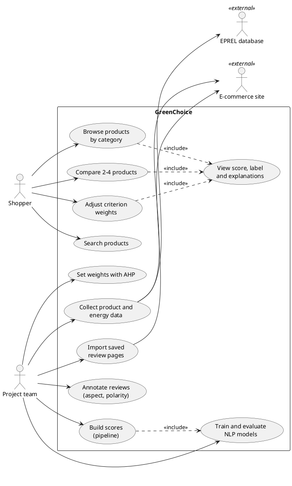
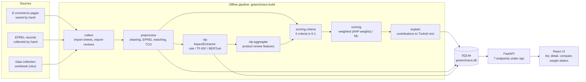
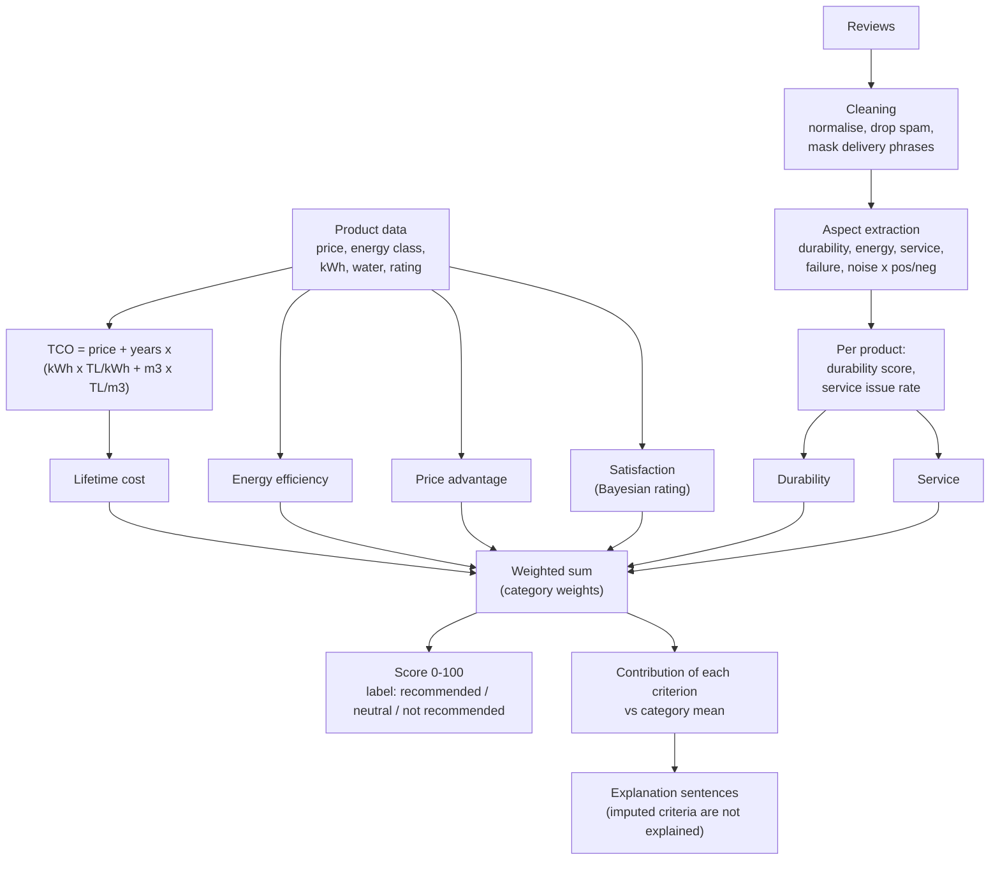
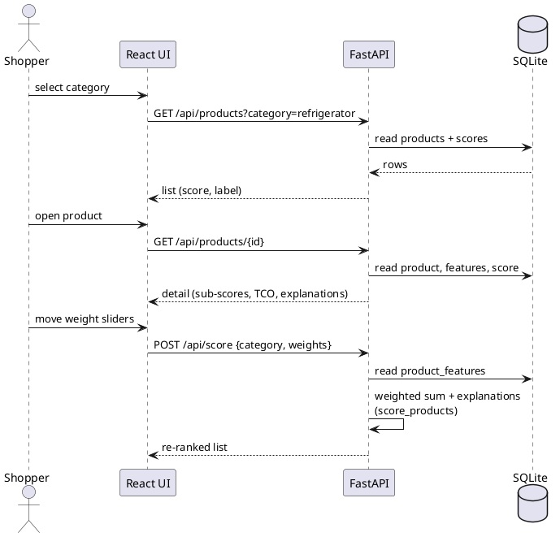
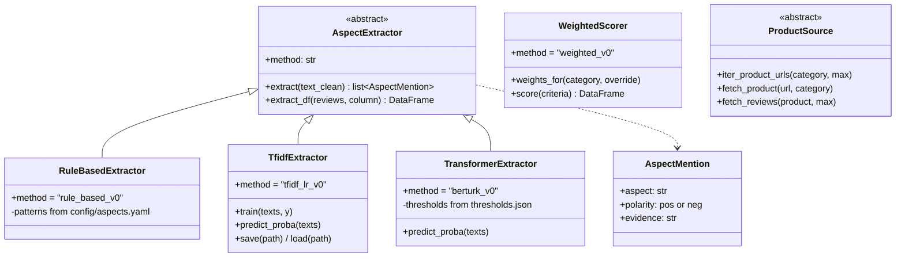
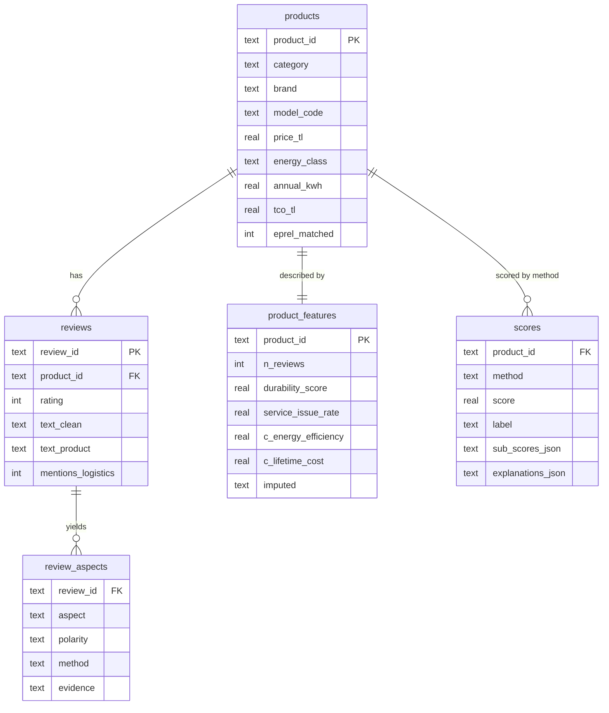
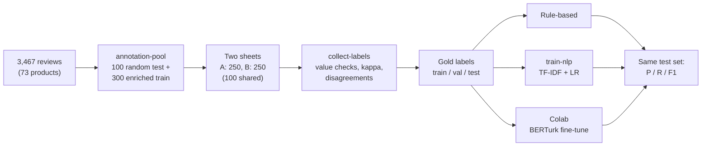

# Diyagramlar (rapor ve sunum için)

Rapor İngilizce olduğu için diyagram etiketleri İngilizcedir. Hepsi koddaki gerçek modül, tablo ve
komut adlarıyla yazıldı (10.11.2026, `demo/entegrasyon` dalındaki durum).

- **Mermaid** blokları GitHub'da doğrudan çizilir. PNG/SVG için https://mermaid.live adresine
  yapıştırıp "Export" kullanın.
- **PlantUML** blokları (UML use case ve sequence) GitHub'da çizilmez. https://www.planttext.com
  adresine yapıştırıp PNG/SVG alın.
- Raporda her diyagramın altına şekil numarası ve açıklama gerekir (hoca diyagramların metinde
  yeterli ayrıntıyla açıklanmasını istiyor). Aşağıdaki "Ne gösteriyor" notları bunun için.

Mimari diyagramının Türkçe sürümü: `architecture.md`.

## 1. Use case diyagramı (rapor 2.2.3)

Ne gösteriyor: Sistemin iki tür kullanıcısı var. **Shopper** (alışveriş yapan kullanıcı) arayüzü
kullanır; **Project team** (geliştirici/analist) verileri toplar, etiketler ve modeli çalıştırır.
EPREL ve e-ticaret siteleri dış sistemlerdir; yorumlar kullanıcı tarafından tarayıcıdan kaydedilen
sayfalardan okunur (otomatik toplama yok).

## 2. Sistem mimarisi (rapor 4.3.1)

Ne gösteriyor: İki parça. **Offline pipeline** bütün hesaplamayı yapar ve sonucu tek bir SQLite
dosyasına yazar. **Servis** (FastAPI + React) yalnızca bu dosyayı okur; tek canlı hesap, kullanıcının
ağırlıkları değiştirdiğinde yapılan ağırlıklı toplamdır. Bu yüzden API hızlı ve basittir, canlı
scraping veya model çıkarımı yoktur.

## 3. Veri akışı ve kriterler (rapor 4.2 "How the system works")

Ne gösteriyor: Bir ürünün skoruna giden yol. Yapısal veriden (fiyat, enerji, su) toplam maliyet;
yorumlardan aspect bazlı duygular; ikisinden altı kriter; ağırlıklı toplamdan skor ve etiket;
kriter katkılarından açıklama cümleleri.

## 4. Sıralama diyagramı: ürün detayı ve özel ağırlık (rapor 4.2)

Ne gösteriyor: Kullanıcı bir kategori seçer, ürün detayını açar ve ağırlıkları değiştirir. Detay ve
açıklama önceden hesaplanmış olarak veritabanından gelir; özel ağırlıkta API skorları yeniden
hesaplar (yalnızca ağırlıklı toplam ve açıklamalar), pipeline yeniden çalışmaz.

## 5. Sınıf diyagramı: genişletme noktaları (rapor 4.3)

Ne gösteriyor: Yöntemler ortak arayüzlerin arkasında değişebilir. Yeni bir NLP yöntemi
`AspectExtractor`'dan türetilir; `build --nlp` hangisinin kullanılacağını seçer.

## 6. Veritabanı şeması (rapor 4.3)

Ne gösteriyor: Pipeline'ın yazdığı beş tablo ve ilişkileri. Kolonların bir kısmı gösterildi;
`product_features` 46 kolonlu bir özellik tablosudur (ham özellikler + yorum özellikleri + kriterler).

## 7. NLP iş akışı: etiketlemeden modele (rapor 3.2 / 4.3)

Ne gösteriyor: Elle etiketleme ve model eğitiminin adımları. Test seti yalnızca son raporlamada
bir kez kullanılır; eşikler doğrulama (val) setinde ayarlanır.

